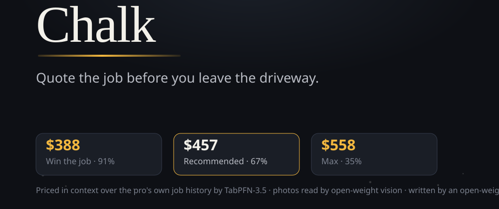

<!--
Submission for the Hacktoberfest Open-Source AI Challenge — Week 2: Side Hustle (#hf26challenge).
Replace cover_image, add the repo link + live demo link before publishing.
-->

## The moment I built for

A cleaner stands in a stranger's kitchen at 6pm. The client is waiting. She has
seen the job for ninety seconds and now she has to name a price.

She has two options and both lose money. Say *"I'll email you tonight"* — and by
tonight the client has two other quotes and picks the fastest one. Or quote from
gut memory on the spot — and either pad it (and lose the job) or undershoot (and
work it at a loss).

**Chalk** is the third option. She photographs the kitchen, holds a button and
talks through what she'd do, and by the time she is back in the van she is
reading a priced, itemized, client-ready quote — priced in context over *her own
last 42 jobs*. Fifteen seconds warm, about half a minute when a photo has to be
read too, and the app prints its own split so the number is checkable.



<!-- For the published post: open submission/cover.svg in a browser and save it at
     1000×420 as a PNG, upload that to DEV, and paste the returned URL into the
     cover_image front-matter above. -->

## What it actually does

| Move | Layer | Open-weight model |
|---|---|---|
| **Walk** | photos + your own words (typed or dictated) | `Qwen3-VL-30B-A3B-Instruct` reads surfaces, rough sizes and price-changing conditions |
| **Price** | itemized scope → price, honest range, odds the client says yes | **`TabPFN-3.5`** in context over your own job history — regression for the price, classification for the win probability |
| **Send** | client message in your voice, private rationale, assumptions, validity | `Qwen3-30B-A3B-Instruct-2507` (or Gemma 4, or Ollama on the laptop) |
| **Answer** | one link (`/q/<id>`) the pro texts: the itemised quote on the client's own phone, with **Accept** / **Not right now** | — (same record, client-safe face) |

A real one, run end to end on this repo — end of lease clean, 3-bed terrace:

```
Clean kitchen surfaces and appliances      2.5h · complexity 4/5     $92
Clean oven interior and exterior           2.0h · complexity 5/5     $85
Clean bathroom 1 / 2                       1.5h each · 3/5          $50 each
Steam clean bedroom 1 / 2 / 3 carpets      1.0h each · 3/5          $34 each
Dust and clean blinds in each bedroom      0.5h each · 2/5          $15 each
Materials and consumables                                           $33
                                                        Total     $457
Fair range for this job: $366 – $548      Win odds: 67%
```

And the part a generic AI assistant cannot give her — the *private* side of the
card:

```
$388  Win the job    91%
$434  Fair           78%
$457  Recommended    67%
$503  Strong         53%
$558  Max            35%
```

(Those rungs are the drawn fallback at this ledger size rather than five separate classifier
answers — why, and the test that decides it, is the story in *Gritty details* below.)

That ladder is the whole business in one card. `$388` is a job she almost
certainly wins and almost certainly resents. `$558` is a coin flip. `$457` is the
number her own history says clears both. Those figures are the actual live output
of the build in this repo. The same walkthrough priced $596 on earlier demo data,
which is the point: the ledger moved, so the price moved.

## The client sees the evidence, not just the number

A price with nothing behind it is an argument. So the quote the client opens carries the
walkthrough: every photo the pro took, captioned by the open-weight vision model, and a thumbnail
sitting **beside the line item it justifies**.

```
What I saw when I priced this — the photo behind each line is on it

[ living room ]                    [ kitchen ]
 living room: dusty carpet,        kitchen: dusty wooden floor,
 dark curtains                     kitchen cabinets

▣ Vacuum living room carpet        1h · complexity 2/5        $46
▣ Mop kitchen wooden floor         1h · complexity 2/5        $30
▣ Degrease kitchen cabinets …      2h · complexity 4/5        $78
▣ Wipe down wall-mounted TV        0.5h · complexity 2/5      $15
  Materials and consumables                                  $16
```

That attribution is not a mock-up: the scope model is asked which photo shows each task, and an
index that points at a photo the pro never took is dropped rather than guessed — a wrong picture
next to a line item is worse than no picture. The pro sees the same strip on their side, with a
count (`4 of 5 line items point at the photo that justifies them`), so nothing is published that
they did not review.

Two details that make it practical on a driveway: photos are **downscaled on the phone** before
they leave it (a 5 MB camera shot becomes ~120 KB, which also cuts the vision call), and list
endpoints never carry them — the pro's job list stays ~15 kB while only the quote page loads the
pictures. It is also the one place where this build touches someone else's personal data, and that
is written down in the README rather than left implicit.

## Why the pricing model is the interesting part

Any LLM can guess a price. Guessing is exactly what the pro already does with her
gut, at the exact moment she has no time to think.

Chalk's price comes from **TabPFN-3.5**, a tabular foundation model that does
in-context learning: you hand it rows — job type, hours, task count, rooms,
average and max complexity, materials, access difficulty, risk count, and whether
the job was won — and it predicts the next row's price, *without* training a model
on that pro's data.

Three things about that matter:

1. **The context is the pro's own jobs.** Not industry averages. The seeded demo
   pro has 42 past jobs with real spread, and every quote that gets an answer —
   accepted or declined — is appended to that context, so the model gets sharper
   as she works. The answer arrives on the client's own phone: the pro sends a
   link, the client taps **Accept**, and that tap is what becomes a training row.
   The client's page never renders the odds, the usual price or the margin.
2. **It answers with a distribution, not a number.** Chalk asks for the 0.1 / 0.5
   / 0.9 quantiles — which is why the quote ships with an honest range
   (`$366 – $548` on the walkthrough above) instead of a false-precision single
   figure. Those quantiles are then clipped to the pro's own ledger, because a
   model's honest uncertainty can still be useless on paper — more on that below.
3. **The win probability is a second head over the same rows.** Classification on
   "did this job get won", which is what turns "here's a price" into "here's what
   your price *does* to your odds".

On the hosted path there is no torch to install: the history is uploaded and
fitted once per history revision, both heads predict in parallel, and the fit is
warmed at boot. Chalk still runs the model three ways — Prior Labs' hosted
TabPFN, a local FastAPI TabPFN service (`services/tabpfn`) where the weights are
installed, and a transparent distance-weighted heuristic over the same rows — and
the UI says which one answered.

## Open weights, all the way down

The challenge asked for open-weight models and this is where that choice stops
being aesthetic:

- **The economics.** A per-image closed vision API turns a pro's busy season into
  a bill. A quote in Chalk costs effectively nothing — a local Ollama model costs
  literally nothing.
- **The data.** Her margin history is the most valuable thing her business owns.
  `CHALK_PROVIDER=ollama` runs vision, scope and prose on the laptop, with no
  server that *could* leak it.
- **Swappability.** Every model call goes through one OpenAI-compatible layer
  (`services/agent/src/lib/llm.ts`), which walks a chain of endpoints until one
  answers and caches the winner. Ollama today, Qwen tomorrow, a **Tinker**
  fine-tune of her own quote voice next week — `services/tinker/train_voice.py`
  distils her accepted-job corpus into a fine-tune and the agent picks it up as a
  sampler.

## Gritty details worth stealing

**Thinking models eat their own token budget.** Gemma 4 on AI Studio narrates
inside `<thought> … </thought>` and that narration is billed from the same
`max_tokens` — cap it tightly and you get an empty answer, not a short one. Chalk
gives those endpoints headroom and strips the thinking block before parsing.

**Small models wrap JSON in prose and code fences.** One parser
(`looseJson`) scoops the outermost JSON object out of the reply, one repair pass
re-asks the model to convert its own output into the schema, and then the code
falls back to a deterministic estimate. Three layers, no exceptions thrown at the
user's expense.

**Latency is a design material.** The first end-to-end quote took **57 seconds**:
the TabPFN path was fitting twice and running the price and the win-probability
heads strictly one after the other. Parallelising the two heads, running the
market lookup and memory recall alongside the pricing call, warming the fit at
boot, and memoising repeat predictions took it to **11–25 seconds warm** (measured
across runs: `scope 2.4–9.3s`, `price 4.4–9.9s`, `words 3.4–5.0s` from words
alone; `eyes 8.8s` too when a photo has to be read). The attribution block prints
that split under every quote, so nobody has to take a number on trust — including
me.

**A model's honest uncertainty can still be useless.** The first live demo quoted
$396 and printed a fair range of **$53–$744**. Both ends were real quantiles from
a real model — over a mixed ledger where a $70 gutter clear sits beside an $800
repaint. No client reads that as a range; they read it as a guess. The fix keeps
the model's interval but clips it to the pro's own ledger (10th–90th percentile
for that job type, and never below 55% of the recommended price), which produced
$218–$499 on the same job. `saneRange` is unit-tested against the exact
$53–$744 case so it cannot come back.

**The writer invented its own expiry.** The quote said `validDays: 14` and the
client message said *"valid for 7 days."* Two numbers, one quote — the kind of
detail a pro would never notice and a client would hold them to. The validity
window now flows into the prompt, into the message, into the stored quote and
into the follow-up workflow from one place, and a regex pass rewrites any
invented window (`valid for`, `good until`, `expires in`) to the real one.

**The tail latencies are the demo.** Prior Labs' predict call is usually ~4s and
occasionally over a minute. On stage, that is not a slow quote, that is a dead
demo. The hosted call now gets a bounded 12-second wait: if it is slow, the local
layer answers, the attribution says so, and the slow call is left running to
price the next quote from cache. Warm-up and the first quote also share one fit
promise — before that, both asked at once, uploaded twice, and produced an
84-second pricing stage.

**I asked the model for the ladder and then refused to show its answer.** Every other build draws
the win-odds curve through a single estimate — five numbers with a slope I chose. TabPFN's API takes
a batch of test rows, so I fitted the classifier with the price the pro charged as a feature and asked
it about all five rungs in one call. It answered every rung. It answered this:

```
$219  66%   ·   $245  67%   ·   $258  67%   ·   $284  65%   ·   $315  67%
```

A real answer from a real fit, and useless: it tells a pro that price does not change their odds. Over
45 jobs with a 68% base rate, the win/lose signal is mostly noise, so the classifier cannot see a price
effect yet — and a card that implies "charge $315, same chance" is worse than no card. `usableBand()`
now requires the ladder to slope (monotone within 6 points of noise, at least a ten-point spread) before
it replaces the drawn shape, and the UI says which one it is showing and why. The guard is unit-tested
against that exact flat ladder. When the ledger grows, the same code starts showing the model's own
numbers with no change to the interface — which is the honest version of "it gets smarter as you use it."

**Every edge is a leaf.** No MongoDB? In-process memory, count shown. No SerpApi?
The market card is simply absent. No vision model? The quote still compiles and
the attribution says `words only — no photos`. No Temporal? Follow-ups are
described, not scheduled, and the card says so. Nothing silently guesses.

## Stack

**Frontend** — Vite + React PWA (`apps/web`), plain CSS, mobile-first, no UI
framework: one thumb, gloves on, sun on the screen.

**Backend** — Hono + Mastra on Node (`services/agent`), with a Mastra agent that
can call tools mid-quote (`market_rate`, `similar_jobs`).

**Partner tech** — Prior Labs **TabPFN** (pricing), **MongoDB Atlas** (job
memory), **Tiger Data** (won/lost margin time-series), **Temporal** (durable
follow-ups), **Sentry** (one trace per compiled quote), **ElevenLabs** (
read-back), **SerpApi** (live market benchmark), **Tinker / Thinking Machines**
(fine-tuned quote voice), **Mastra** (agent + tools).

**Deploy** — one Vercel deployment: a Node function for the API plus the built
PWA. With Fluid compute, functions may run for 300 seconds on the free plan
against a ~15 second quote.

**Tests** — `npm test` runs 38 hermetic specs for the pricing ladder and its
range bound, the validity rewrite, the fallback chain, the vision parser and the
partner integrations; `npm run test:py` covers the TabPFN service. Offline by
default, so contributors need no API keys.

## Partner categories this entry enters

The challenge lets you enter partner categories by using the technology *and naming it*, so — named,
with the exact job each one does here:

| Category | What it actually does in Chalk |
|---|---|
| **TabPFN (Prior Labs)** | The price and the win odds: both heads fitted in-context over the pro's own job history, quantiles for the range, classification for the odds |
| **MongoDB Atlas** | Job memory — every quote stored with a bag-of-words embedding, recalled by similarity into the next quote |
| **Mastra** | The quote-writing agent itself, with `market_rate` and `similar_jobs` tools it can call mid-quote |
| **Sentry** | One trace per compiled quote, with per-stage spans (`quote.compile`, `site.read`) |
| **SerpApi** | The live local market rate on every quote — a real number, not a memorised one |
| **ElevenLabs** | Hands-free read-back of the client message, so the pro can hear it before sending |
| **Temporal** | Durable follow-ups: nudge, expire, and accept signals that survive process restarts |
| **Tiger Data** | The won/lost margin time-series behind the profile screen |
| **Gemma** | The open-weight voice: Gemma 4 serves the local Ollama path, so the whole thing runs on a laptop |

All nine are wired to *degrade*, not to break: pull any of them out and the quote still compiles and
says which layer answered.

## What I'd build next

- **Deliver the link where the client actually is.** The quote URL is real and
  tappable today; sending it should be one button that opens SMS or WhatsApp with
  the message pre-filled, instead of a copy box.
- **Learn from declines, not only wins.** A lost job at a given price is the
  strongest signal in the whole dataset and it is currently one bit. The client's
  *Not right now* tap already arrives; nothing yet learns from the reason behind
  it.
- **Photos as evidence in the quote.** The vision read is in the pro's rationale;
  the client should see "here is what I saw" thumbnails next to the line items.
- **On-device everything.** The models are chosen for it — an Ollama build of
  Chalk is one env var away, and it is the version a trade business would
  actually want.

## Try it

- **Repo:** REPLACE-ME *(public, MIT, everything above is in it)*
- **Live demo:** REPLACE-ME *— or the 90-second video, if the deployment is asleep*
- **Design doc:** [`DESIGN.md`](https://github.com/REPLACE-ME/blob/main/DESIGN.md)
- **Run it locally:** `npm install && npm run build:all && npm start` — no key is required; every
  layer reports the one it is missing.

### Limits, stated plainly

- **Single pro.** There is no auth and no multi-tenancy: one ledger, one device. A real product
  needs accounts before it needs anything else on this list.
- **Latency is the hosted model's, not mine.** Prior Labs' predict swings from ~4s to over a minute,
  which is why the hosted call is capped at 12 seconds and the local layer answers past that.
- **A quote is not a contract.** The scope is read from photos and words; the pro still walks the
  job. The assumptions list exists to make that explicit to the client before they agree to anything.
- **The photo evidence is unmatched for materials.** The materials line is the one line with no
  picture behind it, because a photo of a room does not show the paint you have not bought yet.

> Chalk is named for the thing a pro always has in the van: a way to mark the
> job down before it stops being fresh — and then do a good job of it.
